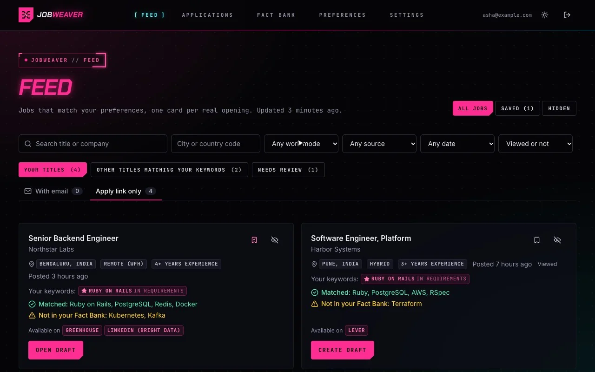
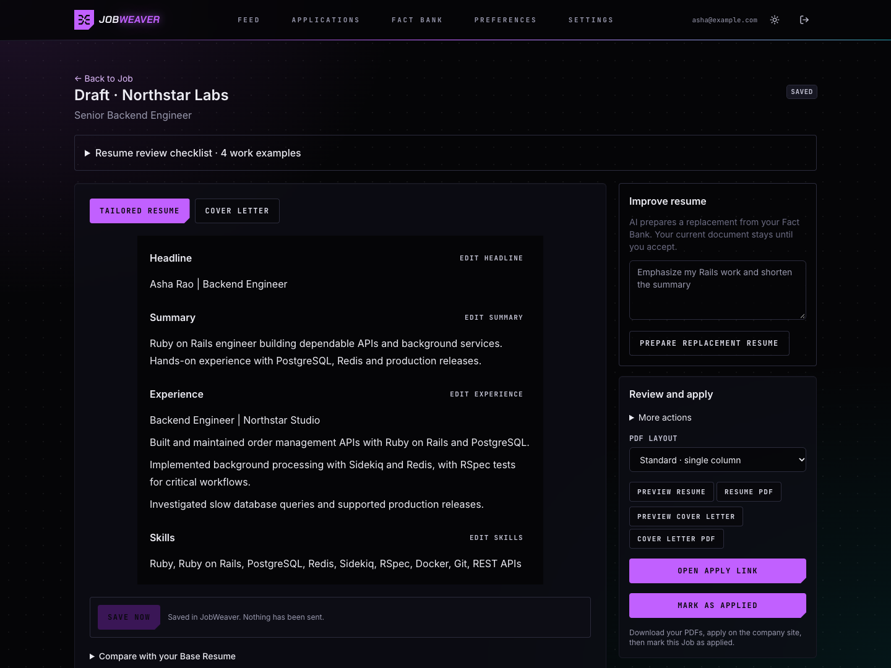
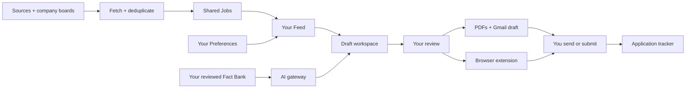

<div align="center">

<picture>
  <source media="(max-width: 600px)" srcset="jobweaver-docs/assets/readme/hero-mobile.svg">
  
</picture>

# Your job search, woven together.

**Find relevant roles. Turn real experience into thoughtful applications. Keep the final say.**

[Open JobWeaver](https://jobweaver.duckdns.org) · [Quickstart](#quickstart) · [Browser extension](#browser-extension) · [Architecture](#architecture) · [Documentation](#documentation)

`Python 3.12` &nbsp; `React 19` &nbsp; `PostgreSQL + pgvector` &nbsp; `Chrome / Brave` &nbsp; `Docker`

</div>

---

JobWeaver brings job discovery, your experience and application preparation into one workspace. It groups the same opening across sources, explains skill gaps, and helps you prepare a resume, cover letter and email from your reviewed **Fact Bank**. A browser extension carries that work onto careers pages and application forms.

**You review the words. You choose the fields. You send or submit.**

## A focused feed. A clearer next step.

<picture>
  <source media="(prefers-reduced-motion: reduce) and (prefers-color-scheme: dark)" srcset="jobweaver-docs/assets/readme/feed-dark.png">
  <source media="(prefers-reduced-motion: reduce)" srcset="jobweaver-docs/assets/readme/feed-light.png">
  
</picture>

<sub>Actual interface with fictional jobs and a sample profile: save a job, open keyword matches, then check Saved. With reduced motion turned on, a still screenshot is shown instead. Click an image to inspect it at full size.</sub>

## From discovery to a deliberate application

<picture>
  <source media="(max-width: 600px)" srcset="jobweaver-docs/assets/readme/workflow-mobile.svg">
  
</picture>

| Your next step | What JobWeaver does |
| :--- | :--- |
| **Find roles worth opening** | Fetches across job sites and company boards, groups duplicate listings, and filters by your titles, keywords, location and work mode. |
| **Understand the fit** | Shows matching keywords and Skill Gaps against your Fact Bank, with uncertain matches under Needs review. |
| **Keep a shortlist** | Saves bookmarks across Feed rebuilds, marks opened jobs Viewed, and remembers filters and pagination. |
| **Prepare your application** | Builds a tailored resume, cover letter and email with references to your reviewed Facts. |
| **Make it yours** | Autosaves edits and presents AI revisions as replacements you can accept or undo. |
| **Apply on the company's site** | Reads a careers-page JD, helps review and fill fields, and attaches the selected documents. Submission stays with you. |
| **Close the loop** | Tracks application statuses, company history and follow-up reminders. |

## Your experience is the source material

A **Fact Bank** is the experience, projects and skills you have reviewed from your own documents. Drafts refer back to those Facts so you can inspect what supports a claim before using it.



<sub>Actual Draft workspace with fictional sample content. No personal resume or production account data is shown.</sub>

- **Evidence you can inspect.** Generated lines carry Fact references; unsupported claims and skills are checked before use.
- **Changes you approve.** A new AI response does not silently replace your current document. Review the replacement first.
- **Documents you can take with you.** Export resume and cover-letter PDFs, create a Gmail draft, or use the application link.
- **A record of what you used.** Document snapshots preserve the context of an application even after later edits.

> [!NOTE]
> Checks help catch unsupported claims; they are not a proof that every paraphrase is correct. Read the final documents before applying. JobWeaver never sends an email or submits an application for you.

## Browser extension

**Start on a careers page, even when the job is not in your Feed.**

1. **Read this job** - capture the page's description, review it, then save it to your own Job context.
2. **Create or choose a Draft** - prepare documents from your Fact Bank and review them in JobWeaver.
3. **Scan this form** - inspect the proposed fields, values and document attachments. Tick only what you want filled.
4. **Fill and review** - check the page yourself. Undo restores what JobWeaver changed, subject to later edits.
5. **Submit yourself** - then use **Mark as applied** to record the application.

The panel supports optional site access, embedded forms, reviewed answer suggestions and Saved Answers. Salary, notice period, work authorisation and similar questions use Saved Answers or your own input. Forms that refuse AI receive notes or eligible user-written answers rather than AI suggestions.

<details>
<summary><strong>Build and connect the extension</strong></summary>

From the repository root:

```bash
cd extension
npm ci
JOBWEAVER_ORIGIN=https://your-host.example npm run build
```

Load `extension/dist` using **Load unpacked** in `chrome://extensions` or `brave://extensions`. The server must allow your extension ID through `EXTENSION_IDS`. Click **Connect**, approve access in JobWeaver, and review your profile before filling.

[Full setup, permissions, downloads and Web Store packaging →](jobweaver-docs/SETUP.md#application-extension)

</details>

## Sources and AI, with visible limits

| Layer | Examples | How it behaves |
| :--- | :--- | :--- |
| **Job discovery** | LinkedIn providers, Naukri, JSearch, Adzuna | Credentials, account limits and provider availability determine what can run. |
| **Company boards** | Greenhouse, Lever, Ashby, SmartRecruiters, Workable, Recruitee, Workday | Listings are normalised into the same shared Job store. Some adapters are off by default. |
| **Remote and community boards** | Remotive, Remote OK, We Work Remotely, Himalayas, Hacker News | Feed matching still follows each User's Preferences. HN comments wait for extraction when AI is unavailable. |
| **AI gateway** | Gemini, Groq, OpenRouter, optional Mistral | Tasks route through configured providers with usage tracking, fallback and recorded responses for tests. |

JobWeaver does not supply provider credits. Free-tier limits, credentials and provider terms remain yours to configure. Source health, budgets and Recent runs make failures visible. See [Costs and fallback behaviour](jobweaver-docs/COSTS.md) and [personal Claude setup](jobweaver-docs/PERSONAL_CLAUDE.md) for the optional, operator-configured route.

## Quickstart

**Fastest local route: Docker Compose.** Copy the example configuration, enable local dev sign-in and recorded AI, then start the stack.

```bash
git clone https://github.com/mitkush/JobWeaver.git
cd JobWeaver
cp .env.example backend/.env
```

Set these values in `backend/.env` for local development:

```dotenv
DEV_LOGIN_ENABLED=true
GATEWAY_MODE=recorded
```

```bash
docker compose up --build
```

Open **[localhost:8000](http://localhost:8000)**. Compose starts PostgreSQL with pgvector, runs migrations and serves the built frontend and API together. Compose mounts the recorded responses read-only from `backend/tests/fixtures/gateway`; they are not included in the production image. Recorded AI makes no model calls, uses fixed fixtures and does not seed a ready-made job Feed. Configure Sources to collect real jobs.

<details>
<summary><strong>Prefer running the backend and frontend separately?</strong></summary>

Needs Python 3.12, Node 22 and PostgreSQL 16 with pgvector. After copying and editing `backend/.env`:

```bash
docker compose up -d postgres

cd backend
python3.12 -m venv .venv
.venv/bin/pip install -e ".[dev]"
.venv/bin/alembic upgrade head
.venv/bin/uvicorn app.main:app --reload --port 8000
```

In a second terminal, from the repository root:

```bash
cd frontend
npm ci
npm run dev
```

Open **[localhost:5173](http://localhost:5173)**. The Vite server proxies API requests to port 8000.

</details>

[Google OAuth, Gmail, provider keys and production deployment →](jobweaver-docs/SETUP.md)

## Architecture

One application serves the API and production frontend. PostgreSQL stores shared Jobs and per-user application data; the browser extension connects to the same API.



| Component | Implementation |
| :--- | :--- |
| **API and services** | Python 3.12, FastAPI, Pydantic, SQLAlchemy, Alembic |
| **Web app** | React 19, TypeScript, Vite, Tailwind CSS, TanStack Query |
| **Storage and matching** | PostgreSQL 16, pgvector, per-user Feed links |
| **Application extension** | TypeScript, Chromium Manifest V3, side panel |
| **Deployment** | Docker, Caddy, versioned deploy scripts |
| **Installable app** | Web manifest and browser installation; internet access required |

## Development checks

```bash
# Backend: isolated test database required
cd backend
.venv/bin/ruff check .
.venv/bin/ruff format --check .
.venv/bin/pytest

# Frontend
cd ../frontend
npm run typecheck
npm run lint
npm test
npm run build

# Extension
cd ../extension
npm run typecheck
npm test
npm run build
```

Tests use recorded AI responses and make no live model calls. Set `TEST_DATABASE_URL` to a dedicated PostgreSQL test database. After a backend API change, regenerate client types with `npm run gen:api` in `frontend/`.

[GitHub Actions checks →](https://github.com/mitkush/JobWeaver/actions/workflows/ci.yml)

## Documentation

| Start here | Go deeper |
| :--- | :--- |
| [Setup and operations](jobweaver-docs/SETUP.md) | [Architecture decisions](jobweaver-docs/docs/adr/) |
| [Product requirements](jobweaver-docs/PRD.md) | [Domain glossary](jobweaver-docs/CONTEXT.md) |
| [Provider costs and limits](jobweaver-docs/COSTS.md) | [Description matching](jobweaver-docs/DESCRIPTION_MENTIONS.md) |
| [Browser extension plan](jobweaver-docs/APPLICATION_EXTENSION_PLAN.md) | [Extension store packaging](jobweaver-docs/EXTENSION_STORE_LISTING.md) |
| [Application UX plan](jobweaver-docs/APPLICATION_UX_PLAN.md) | [Install as an app](jobweaver-docs/PWA.md) |

---

<div align="center">

**Less time managing the search. More attention on the right application.**

[Open JobWeaver](https://jobweaver.duckdns.org) · [Get started](#quickstart) · [Explore the docs](#documentation)

</div>
